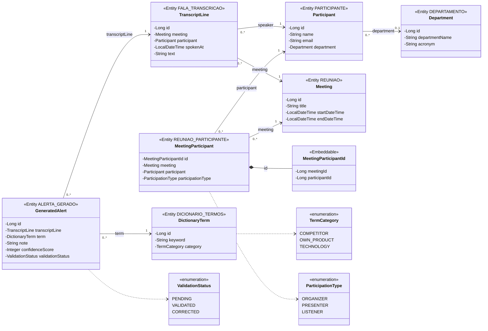

# Nous Sight — Class Diagram (Sprint 4)

Two diagrams in Mermaid `classDiagram` syntax, rendered by GitHub and by
https://mermaid.live (export to PNG/SVG for the PDF).

1. **Domain model**: entities, the composite key and the enums, with the
   Oracle table/column each one maps to.
2. **Layers**: controllers → services → repositories, plus error handling and
   configuration.

## 1. Domain model

Each entity maps to one table of `Docs/sql/sprint4.sql`. IDs come from the
`SEQ_<TABLE>` sequences. The enums are stored as Portuguese values through
the converters in the `domain` package:

| Enum | Converter | Stored values |
|---|---|---|
| `ValidationStatus` | `ValidationStatusConverter` | `'Pendente'`, `'Validado'`, `'Corrigido'` |
| `TermCategory` | `TermCategoryConverter` | `'Time Rival'`, `'Produto Próprio'`, `'Tecnologia'` |
| `ParticipationType` | `ParticipationTypeConverter` | `'Organizador'`, `'Apresentador'`, `'Ouvinte'` |

## 2. Layers

Each controller calls its service; services call repositories and, to look
up related records, other services. Every repository extends
`JpaRepository<Entity, Long>` (`MeetingParticipantRepository` uses
`MeetingParticipantId` as its key) and inherits `save`, `findById`,
`findAll` and `delete`. Only the derived finders are listed below.

```mermaid
classDiagram
    direction TB

    class DepartmentController {
        <<RestController /api/departments>>
    }
    class ParticipantController {
        <<RestController /api/participants>>
    }
    class MeetingController {
        <<RestController /api/meetings>>
        +analyzeTranscript(Long id, TranscriptRequest) TranscriptAnalysisResult
        +summary(Long id) MeetingSummaryDTO
        +churnRisk(Long id) Map
    }
    class TranscriptLineController {
        <<RestController /api/transcript-lines>>
    }
    class DictionaryTermController {
        <<RestController /api/dictionary-terms>>
    }
    class AlertController {
        <<RestController /api/alerts>>
        +findPending() List~GeneratedAlert~
        +validate(Long id, AlertValidationRequest) GeneratedAlert
    }

    class DepartmentService {
        +findAll() List~Department~
        +findById(Long) Department
        +create(DepartmentRequest) Department
        +update(Long, DepartmentRequest) Department
        +delete(Long)
    }
    class ParticipantService {
        +findAll() List~Participant~
        +findById(Long) Participant
        +create(ParticipantRequest) Participant
        +update(Long, ParticipantRequest) Participant
        +delete(Long)
    }
    class MeetingService {
        +findAll() List~Meeting~
        +findById(Long) Meeting
        +create(MeetingRequest) Meeting
        +update(Long, MeetingRequest) Meeting
        +delete(Long)
    }
    class MeetingParticipantService {
        +findByMeeting(Long) List~MeetingParticipant~
        +add(Long, MeetingParticipantRequest) MeetingParticipant
        +remove(Long, Long)
        +isLinked(Long, Long) boolean
    }
    class DictionaryTermService {
        +findAll() List~DictionaryTerm~
        +findById(Long) DictionaryTerm
        +create(DictionaryTermRequest) DictionaryTerm
        +update(Long, DictionaryTermRequest) DictionaryTerm
        +delete(Long)
    }
    class TranscriptLineService {
        +findAll() List~TranscriptLine~
        +findById(Long) TranscriptLine
        +create(TranscriptLineRequest) TranscriptLine
        +update(Long, TranscriptLineRequest) TranscriptLine
        +delete(Long)
        +findByMeeting(Long) List~TranscriptLine~
    }
    class AlertService {
        +needsHumanValidation(GeneratedAlert) boolean
        +registerHumanValidation(Long, boolean, String) GeneratedAlert
        +calculateAverageConfidenceScore(Long) double
        +findPending() List~GeneratedAlert~
        +findByMeeting(Long) List~GeneratedAlert~
        +create(AlertRequest) GeneratedAlert
        +update(Long, AlertRequest) GeneratedAlert
    }
    class ClientHistoryService {
        +calculateChurnRisk(Long) String
        +generateMeetingSummary(Long) MeetingSummaryDTO
    }
    class TranscriptAnalysisService {
        +analyze(Long, TranscriptRequest) TranscriptAnalysisResult
        -mentions(String, String) boolean
        -scoreFor(DictionaryTerm) int
    }

    class DepartmentRepository {
        <<JpaRepository>>
        +existsByAcronymIgnoreCase(String) boolean
    }
    class ParticipantRepository {
        <<JpaRepository>>
        +existsByEmailIgnoreCase(String) boolean
        +existsByDepartment_Id(Long) boolean
    }
    class MeetingRepository {
        <<JpaRepository>>
    }
    class MeetingParticipantRepository {
        <<JpaRepository>>
        +findByMeeting_Id(Long) List~MeetingParticipant~
        +existsByMeeting_IdAndParticipationType(Long, ParticipationType) boolean
    }
    class DictionaryTermRepository {
        <<JpaRepository>>
        +existsByKeywordIgnoreCase(String) boolean
    }
    class TranscriptLineRepository {
        <<JpaRepository>>
        +findByMeeting_IdOrderBySpokenAt(Long) List~TranscriptLine~
    }
    class GeneratedAlertRepository {
        <<JpaRepository>>
        +findByValidationStatus(ValidationStatus) List~GeneratedAlert~
        +findByTranscriptLine_Meeting_Id(Long) List~GeneratedAlert~
        +countByTranscriptLine_Meeting_IdAndTerm_Category(Long, TermCategory) long
    }

    class ApiExceptionHandler {
        <<RestControllerAdvice>>
        +handleNotFound(ResourceNotFoundException) 404
        +handleBusiness(BusinessException) 422
        +handleValidation(MethodArgumentNotValidException) 400
    }
    class ResourceNotFoundException
    class BusinessException
    RuntimeException <|-- ResourceNotFoundException
    RuntimeException <|-- BusinessException
    ApiExceptionHandler ..> ResourceNotFoundException
    ApiExceptionHandler ..> BusinessException

    class SecurityConfig {
        <<Configuration>>
        HTTP Basic, users aluno / admin
    }
    class CorsConfig {
        <<Configuration>>
        /api/** from localhost:5500
    }
    class OpenApiConfig {
        <<Configuration>>
        Swagger, basicAuth scheme
    }

    DepartmentController --> DepartmentService
    ParticipantController --> ParticipantService
    TranscriptLineController --> TranscriptLineService
    DictionaryTermController --> DictionaryTermService
    AlertController --> AlertService
    MeetingController --> MeetingService
    MeetingController --> MeetingParticipantService
    MeetingController --> TranscriptLineService
    MeetingController --> TranscriptAnalysisService
    MeetingController --> AlertService
    MeetingController --> ClientHistoryService

    DepartmentService --> DepartmentRepository
    DepartmentService --> ParticipantRepository
    ParticipantService --> ParticipantRepository
    ParticipantService --> DepartmentService
    MeetingService --> MeetingRepository
    MeetingParticipantService --> MeetingParticipantRepository
    MeetingParticipantService --> MeetingService
    MeetingParticipantService --> ParticipantService
    DictionaryTermService --> DictionaryTermRepository
    TranscriptLineService --> TranscriptLineRepository
    TranscriptLineService --> MeetingParticipantService
    AlertService --> GeneratedAlertRepository
    AlertService --> TranscriptLineService
    AlertService --> DictionaryTermService
    ClientHistoryService --> GeneratedAlertRepository
    ClientHistoryService --> AlertService
    TranscriptAnalysisService --> TranscriptLineService
    TranscriptAnalysisService --> DictionaryTermService
    TranscriptAnalysisService --> AlertService
    TranscriptAnalysisService --> ClientHistoryService
```

Dependencies left out of diagram 2 to keep it readable: the services that only
call another repository for an "exists" check before a delete
(`ParticipantService`, `MeetingService` → `TranscriptLineRepository` /
`MeetingParticipantRepository`; `DictionaryTermService`,
`TranscriptLineService` → `GeneratedAlertRepository`), and the
`MeetingService.findById` lookups used to return 404 for unknown meetings.
